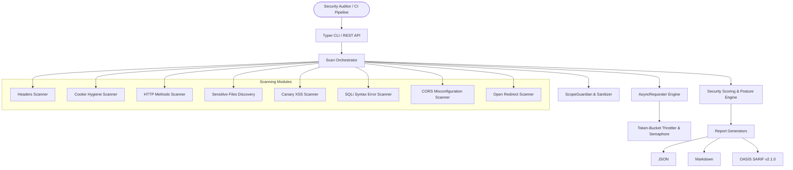

# Web Security Scanner (`webscan`)

[](https://github.com/cyber-portfolio/web-security-scanner/actions/workflows/ci.yml)
[](https://www.python.org/)
[](https://opensource.org/licenses/MIT)
[](https://github.com/astral-sh/ruff)
[](https://github.com/PyCQA/bandit)
[](https://pytest.org/)

An enterprise-grade, asynchronous web application vulnerability scanner and security posture evaluation engine. Features strict scope boundaries, non-destructive active probes, CVSS-based scoring, multi-format reporting (JSON, Markdown, SARIF v2.1.0), and a built-in security lab.

---

## Architecture Overview



---

## Key Capabilities

1. **Safety & Scope Boundary Isolation (`ScopeGuardian`)**:
   - Enforces domain boundaries and wildcard subdomains (`*.domain.tld`).
   - Re-checks every redirect hop target to prevent Open Redirect-to-SSRF attacks (e.g., blocking redirects to cloud metadata `169.254.169.254`).
2. **Defensive, Non-Destructive Vulnerability Scanners**:
   - **Security Headers**: HSTS, CSP, X-Frame-Options, X-Content-Type-Options, Referrer-Policy, and banner disclosures.
   - **Cookie Attributes**: Evaluates `Secure`, `HttpOnly`, and `SameSite` flags.
   - **HTTP Verbs**: Flags dangerous methods (TRACE, PUT, DELETE, OPTIONS).
   - **Sensitive Files**: Probes `.env`, `.git/HEAD`, `robots.txt`, `security.txt`, and database backups using regex content signatures to eliminate soft-404 false positives.
   - **Canary XSS**: Injects inert, safe canary tokens (`<webscan-xss-canary>`) into parameters to check unescaped reflection.
   - **SQL Error Disclosure**: Injects syntax probes (`'`, `"`, `\`) and matches against 13 database error signatures.
   - **CORS Misconfiguration**: Detects arbitrary origin reflections and wildcard origins with credentials enabled.
   - **Open Redirects**: Checks unvalidated destination parameters.
3. **Quantitative Scoring & Posture Grading**:
   - Calculates a CVSS-weighted score ($0-100$) and assigns a qualitative letter grade (**A**, **B**, **C**, **D**, **F**).
4. **DevSecOps Multi-Format Reporting**:
   - **JSON**: Clean machine-readable serialization.
   - **Markdown**: Formatted executive summaries and remediation guidance.
   - **OASIS SARIF v2.1.0**: Native integration with GitHub Code Scanning alerts.
5. **Built-in Offline Security Lab**:
   - Embedded FastAPI testing target simulating all 8 vulnerability classes for offline testing and verification.

---

## Quickstart & Installation

### 1. Setup Virtual Environment

```bash
git clone https://github.com/cyber-portfolio/web-security-scanner.git
cd web-security-scanner
python3 -m venv .venv
source .venv/bin/activate
pip install -e ".[dev]"
```

### 2. Run the Built-In Vulnerability Lab

Launch the local test sandbox in a terminal:

```bash
webscan lab --port 8888
```

### 3. Run a Security Scan

Run an automated assessment against the target:

```bash
# Terminal summary output
webscan scan http://localhost:8888/

# Exporting SARIF report for GitHub Code Scanning
webscan scan http://localhost:8888/ --format sarif --output report.sarif

# Exporting Markdown assessment report
webscan scan http://localhost:8888/ --format markdown --output report.md

# Quick single-target HTTP header probe
webscan probe http://localhost:8888/
```

### 4. CI/CD Gate Enforcement

Use the `--fail-on-high` flag to fail CI/CD build pipelines if High or Critical vulnerabilities are detected:

```bash
webscan scan https://staging.example.com/ --fail-on-high
```

---

## REST API Microservice

Run the scanner as an asynchronous REST microservice:

```bash
uvicorn webscan.api.app:api_app --host 0.0.0.0 --port 8000
```

- **Interactive Swagger Docs**: `http://localhost:8000/docs`
- **Health Check**: `GET /health`
- **Execute Scan**: `POST /api/v1/scan`
- **Quick Probe**: `POST /api/v1/probe`
- **Lookup Report**: `GET /api/v1/scans/{scan_id}`

---

## Docker Deployment

Run the rootless container (UID `10001:10001`):

```bash
docker compose up --build -d
curl http://localhost:8000/health
```

---

## Quality & DevSecOps Verification

Run all static analysis, security audits, and test suites:

```bash
# Code style and formatting
ruff check . && ruff format --check .

# Strict type checking
mypy src tests

# SAST security audit
bandit -c pyproject.toml -r src

# Unit and integration test suite with coverage gate
pytest -v --cov=webscan --cov-report=term-missing --cov-fail-under=90
```

---

## License

This project is licensed under the MIT License. See [LICENSE](LICENSE) for details.
