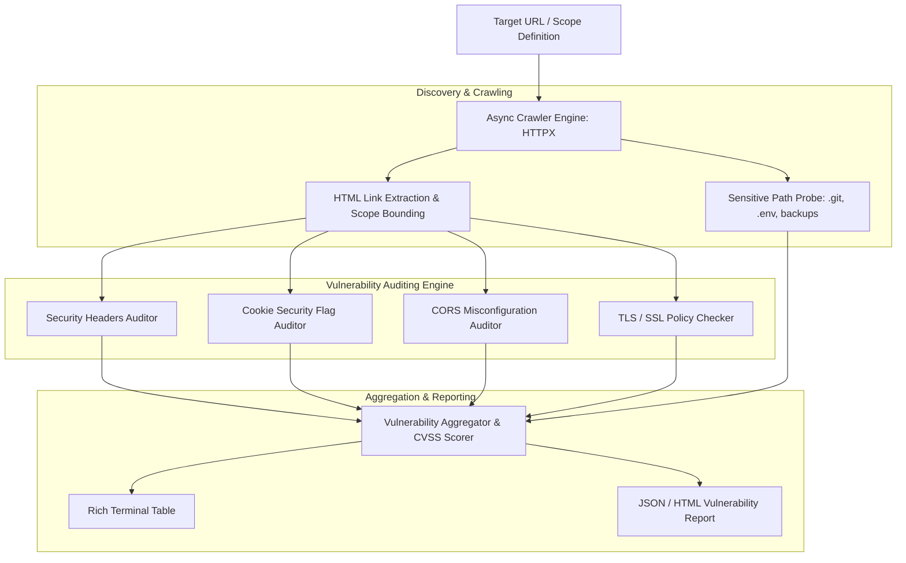

# Web Security Scanner (`webscan`)

Enterprise-Grade Asynchronous Web Security Assessment & Vulnerability Scanner for Modern Web Applications.

[](https://github.com/Krish9800/web-security-scanner/actions)
[](LICENSE)
[](https://www.python.org/)
[](https://www.python-httpx.org/)
[](https://typer.tiangolo.com/)

---

## Overview & Problem Statement

Web applications are the primary target for external cyber attacks. Misconfigured security headers, insecure session cookies, permissive CORS policies, and sensitive file disclosures (such as exposed `.git` directories or `.env` files) frequently provide attackers with initial access.

**Web Security Scanner** is a fast, asynchronous security auditing tool built in Python 3.12. It crawls target domains, audits HTTP response headers against OWASP and NIST recommendations, analyzes cookie security flags, inspects CORS configurations, tests for sensitive path disclosures, and generates actionable vulnerability reports.

---

## Architecture & Data Flow



---

## Verified Features

- **Asynchronous Crawling:** High-throughput URL discovery and crawling powered by `httpx` and `asyncio` with strict rate limiting and scope boundary controls.
- **Security Headers Auditing:** Evaluates presence and configuration of `Content-Security-Policy` (CSP), `Strict-Transport-Security` (HSTS), `X-Frame-Options`, `X-Content-Type-Options`, and `Referrer-Policy`.
- **Cookie Security Analysis:** Verifies `Secure`, `HttpOnly`, and `SameSite` (Strict/Lax) attributes across all set cookies.
- **CORS Misconfiguration Checks:** Tests for reflected origins, `null` origin trust, and overly permissive credential sharing (`Access-Control-Allow-Credentials: true` with wildcard origins).
- **Sensitive Path Disclosure Probing:** Checks for exposed administrative panels, configuration files (`.env`, `wp-config.php`), version control repositories (`.git/HEAD`), and backup archives.
- **Dual Interface:** Typer CLI with Rich terminal reporting, plus a FastAPI REST backend.

---

## Technology Stack

- **Runtime:** Python 3.12+
- **HTTP Client:** HTTPX (Async)
- **HTML Parsing:** BeautifulSoup4
- **CLI Framework:** Typer & Rich
- **API Framework:** FastAPI & Uvicorn
- **Testing:** Pytest, Ruff, Mypy, Bandit

---

## Requirements & Installation

```bash
# Clone the repository
git clone https://github.com/Krish9800/web-security-scanner.git
cd web-security-scanner

# Create and activate virtual environment
python3 -m venv .venv
source .venv/bin/activate

# Install dependencies
pip install -e .
```

---

## Verified Usage Examples

### 1. Command-Line Interface (CLI)

```bash
# Perform a comprehensive scan against a target URL
webscan scan https://example.com

# Quick header-only audit (non-crawling probe)
webscan scan https://example.com --headers-only

# Deep crawl scan with maximum depth of 3 and JSON report export
webscan scan https://example.com --max-depth 3 --format json --output report.json

# Probe a single endpoint for sensitive paths
webscan probe https://example.com

# Start an embedded local practice lab target
webscan lab --port 8080
```

### 2. REST API Service

```bash
# Launch the scanner REST API
uvicorn webscan.api.app:app --host 127.0.0.1 --port 8000
```

Endpoints available at `http://127.0.0.1:8000/docs`:
- `GET /health` — Service health check
- `POST /api/v1/scan` — Submit asynchronous target scan
- `GET /api/v1/scan/{scan_id}` — Poll scan progress and results

---

## Testing & Quality Gates

```bash
# Run complete test suite with coverage
pytest --cov=webscan --cov-report=term-missing

# Linting and static analysis
ruff check .
ruff format --check .
mypy src/webscan
```

---

## Security Model & Safe Scope

- **Non-Destructive Scanning:** Checks are strictly read-only and passive. Does not inject destructive SQL payloads, perform denial-of-service flooding, or exploit found flaws.
- **Scope Bounding:** The crawler strictly obeys domain boundaries and never traverses external third-party links found on the target.
- **Rate Limiting:** Employs configurable request throttling (default 10 req/sec) to prevent adverse target impact.

---

## Limitations & Known Issues

- **Client-Side SPA Rendering:** The built-in crawler parses static HTML responses; complex JavaScript-rendered Single Page Applications (React/Vue requiring headless Chromium) are crawled via direct endpoint discovery rather than DOM execution.
- **Authentication:** Currently supports Bearer and Basic authentication headers; multi-step OAuth2 login flows require pre-authenticated session cookies.

---

## License & Responsible Use

This project is licensed under the **MIT License** — see the [LICENSE](LICENSE) file for details.

> [!CAUTION]
> **Authorization Required:** Scan only web targets and applications that you own or have explicit written permission to test.
